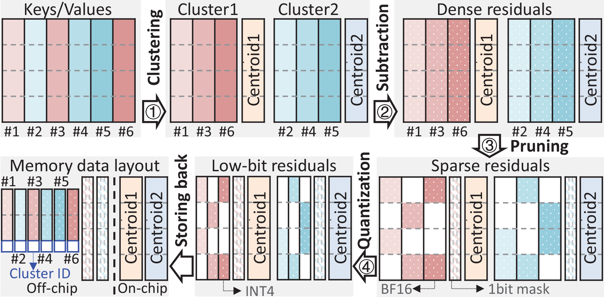

# ResKV: Residual-based Channel-wise Unstructured Pruning for KV Cache Compression



## Installation

Use Linux and Python 3.12. [constraints.txt](constraints.txt) pins the environment:
PyTorch 2.8.0, Transformers 4.57.1 and CUDA 12.8.

```bash
git clone https://github.com/coralabo/ResKV.git
cd ResKV
python3.12 -m venv .venv
source .venv/bin/activate
python -m pip install --upgrade pip
python -m pip install torch==2.8.0 --index-url https://download.pytorch.org/whl/cu128
python -m pip install -c constraints.txt -e '.[eval]'
python -m pip check
```

Accuracy evaluation runs in PyTorch without compiling CUDA kernels. Performance
benchmarks additionally require the CUDA 12.8 toolkit, Ninja and a compatible
C++ compiler, and run on **NVIDIA RTX PRO 6000 Blackwell Server Edition**.

```bash
export CUDA_HOME=/usr/local/cuda-12.8
export PATH="$CUDA_HOME/bin:$PATH"
export MAX_JOBS=4
nvcc --version
nvidia-smi
```

## Models and data

Use local Hugging Face checkpoint directories. Authenticate with `hf auth login`
when downloading gated models.

```bash
hf download meta-llama/Meta-Llama-3-8B-Instruct \
  --revision 8afb486c1db24fe5011ec46dfbe5b5dccdb575c2 --local-dir /models/llama-3-8b-instruct
hf download meta-llama/Llama-3.1-8B-Instruct --local-dir /models/llama-3.1-8b-instruct
hf download Qwen/Qwen3-8B \
  --revision b968826d9c46dd6066d109eabc6255188de91218 --local-dir /models/qwen3-8b
hf download THUDM/LongBench data.zip --repo-type dataset \
  --revision 5e628be450b7e67fb7ae6e201bd6d8f7056f7672 --local-dir /data/longbench
python -m zipfile -e /data/longbench/data.zip /data/longbench
```

| Experiment | Checkpoints |
| --- | --- |
| LongBench | Llama-3-8B-Instruct, Qwen3-8B |
| RULER | Llama-3.1-8B-Instruct, Qwen3-8B |
| Performance | Llama-3.1-8B-Instruct |

Generate RULER inputs for each model's tokenizer at 16K context length using the
[data preparation instructions](docs/evaluation.md#prepare-ruler-data). Keep a
separate dataset directory for each tokenizer.

## Accuracy experiments

The accuracy path clusters pre-RoPE Keys and Values, sparsifies the residuals,
optionally quantizes them, and reconstructs dense KV for attention. Defaults are
32 clusters, a recent window of 32, 4 sink tokens, groups of 64 and 15 K-means
iterations. Prompt formatting and generation settings are selected by model and
task. The [evaluation guide](docs/evaluation.md) describes the input fields.

| Configuration | `--sparsity` | `--bits` |
| --- | ---: | ---: |
| Dense control | 0 | 16 |
| 50% / 75% / 87.5% sparsity | 0.5 / 0.75 / 0.875 | 16 |
| 50% sparsity + INT4 / INT2 | 0.5 | 4 / 2 |
| 75% sparsity + INT4 / INT2 | 0.75 | 4 / 2 |

Set the checkpoint and output directory for each model/configuration. Add
`--limit 2` to a generation command for a short run; omit it to process the task.

### LongBench

Run all 16 English and code tasks, then compute their unweighted mean score:

```bash
reskv_model=/models/llama-3-8b-instruct
reskv_sparsity=0.75
reskv_bits=16
reskv_output=results/longbench/llama3/sparse75
for reskv_task in narrativeqa qasper multifieldqa_en hotpotqa 2wikimqa musique \
  gov_report qmsum multi_news trec triviaqa samsum passage_count \
  passage_retrieval_en lcc repobench-p; do
  python -m evaluation.run --suite longbench --dataset "$reskv_task" \
    --input "/data/longbench/data/$reskv_task.jsonl" --model "$reskv_model" \
    --sparsity "$reskv_sparsity" --bits "$reskv_bits" --max-input-tokens 8192 \
    --output "$reskv_output/$reskv_task.jsonl" || exit 1
done
reskv-score --suite longbench --input "$reskv_output" --output "$reskv_output/scores.json"
```

For Qwen3, set `reskv_model=/models/qwen3-8b` and a separate output directory.
Change `reskv_sparsity` and `reskv_bits` for the other configurations above.

### RULER

Prepare all 13 tasks for the selected checkpoint before running this loop:

```bash
reskv_model=/models/llama-3.1-8b-instruct
reskv_data=/data/ruler/llama31
reskv_sparsity=0.75
reskv_bits=16
reskv_output=results/ruler/llama31/sparse75
for reskv_task in niah_single_1 niah_single_2 niah_single_3 \
  niah_multikey_1 niah_multikey_2 niah_multikey_3 niah_multivalue niah_multiquery \
  vt cwe fwe qa_1 qa_2; do
  python -m evaluation.run --suite ruler --dataset "$reskv_task" \
    --input "$reskv_data/$reskv_task/validation.jsonl" --model "$reskv_model" \
    --sparsity "$reskv_sparsity" --bits "$reskv_bits" --max-input-tokens 16384 \
    --output "$reskv_output/$reskv_task.jsonl" || exit 1
done
reskv-score --suite ruler --input "$reskv_output" --output "$reskv_output/scores.json"
```

For Qwen3, use its checkpoint and tokenizer-specific RULER data directory.
Each task writes prediction JSONL and a sibling `.summary.json`. Scoring can be
run separately on the saved predictions. The [Mustafar adapter](docs/mustafar.md)
uses the same task inputs and scorer for accuracy comparisons.

## Performance experiments

Use FP16 Llama-3.1-8B-Instruct, 8192 input tokens and 2048 output tokens. The
performance interface evaluates **50% or 75% sparsity without quantization**.
ResKV uses 32 initial clusters, a recent window of 32, groups of 64 and 10 K-means
iterations. Kernel selection is automatic.

Set up the [Mustafar environment and extension](docs/mustafar.md), then run:

```bash
for reskv_sparsity in 0.5 0.75; do
  python -m benchmarks.compare --model /models/llama-3.1-8b-instruct \
    --methods reskv mustafar dense --batch-sizes 1 4 8 16 32 \
    --input-length 8192 --new-tokens 2048 --sparsity "$reskv_sparsity" \
    --warmup 1 --repeats 3 \
    --mustafar-root /path/to/mustafar \
    --mustafar-python /path/to/mustafar-env/bin/python \
    --output "results/performance/sparsity$reskv_sparsity" || exit 1
done
```

Use `--methods reskv dense` to run without Mustafar. Select a GPU with
`CUDA_VISIBLE_DEVICES` on a multi-GPU machine.

Methods run sequentially in fresh processes with matching inputs. Results
include prefill time, decode TPOT, end-to-end throughput and peak allocated
memory; `summary.json` aggregates repeated runs. See the [benchmark guide](docs/benchmarks.md)
for single-method commands, metric definitions and kernel measurements.

## License

[Apache-2.0](LICENSE). Third-party attributions are listed in [NOTICE](NOTICE).
